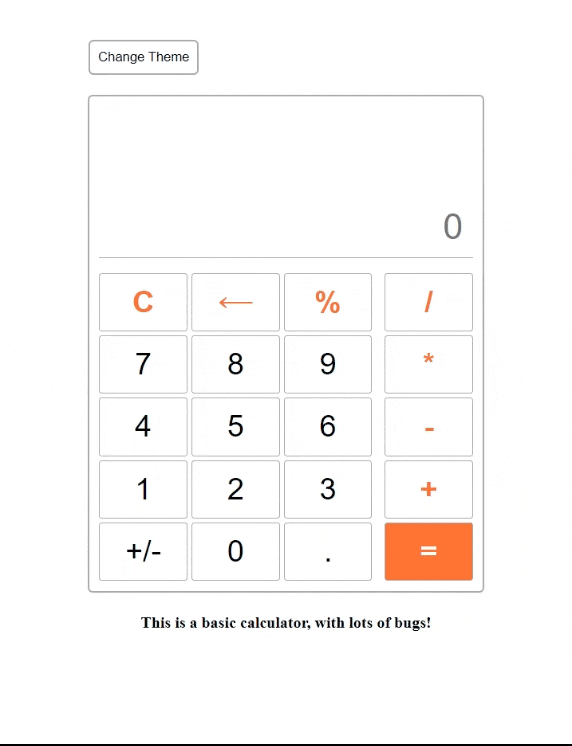

# Calculator

A simple calculator app built with HTML, CSS, and JavaScript. It supports basic arithmetic operations and includes a theme toggle for a light/dark mode switch.

## Preview



## Features

- Basic arithmetic: addition, subtraction, multiplication, division, and percentage
- Backspace and clear functionality
- Theme toggle to switch between light and dark styling
- No build step or dependencies required

## Run locally

1. Clone the repository:

   ```bash
   git clone https://github.com/abdulalisadaqat/simple-js-calculator.git
   ```
2. Open `index.html` in your browser

## Project files

- `index.html` — app structure
- `style.css` — page styling
- `script.js` — calculator logic
- `change_theme.js` — theme-switch behavior
- `preview.gif` — project preview animation

## Notes

This project is intentionally lightweight and beginner-friendly, making it a good example of a small frontend calculator with UI behavior handled in vanilla JavaScript.
